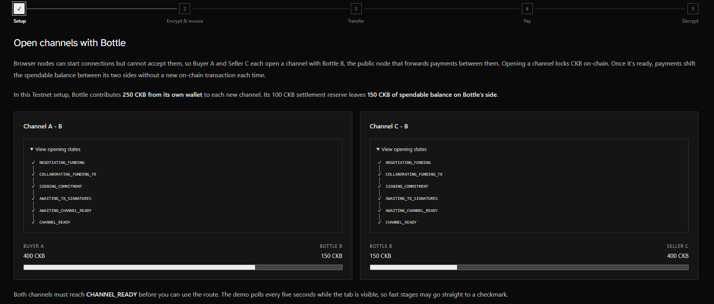
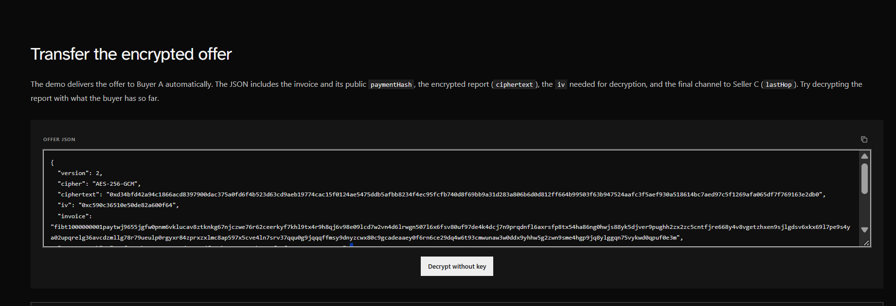
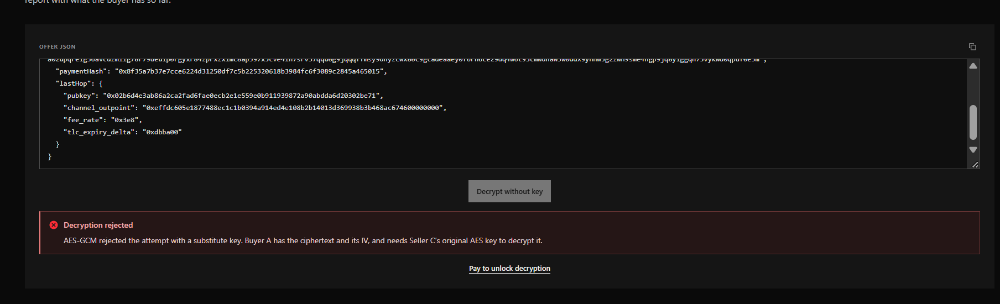
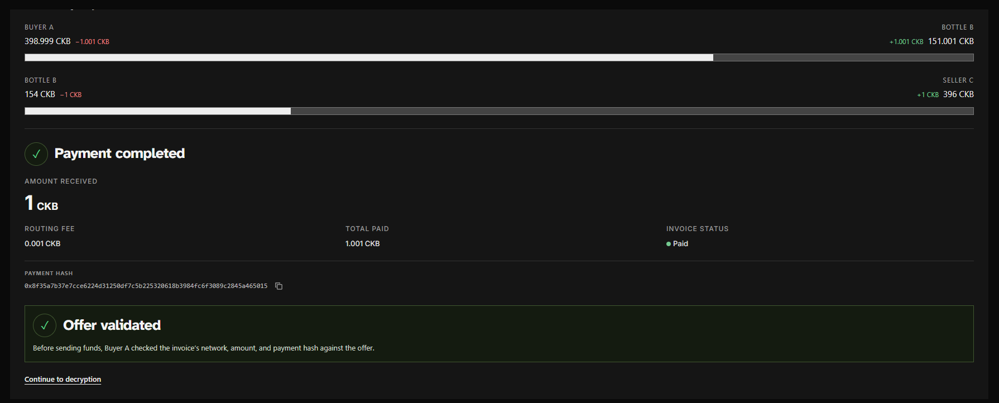
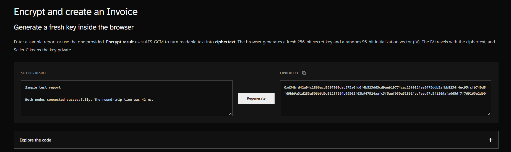
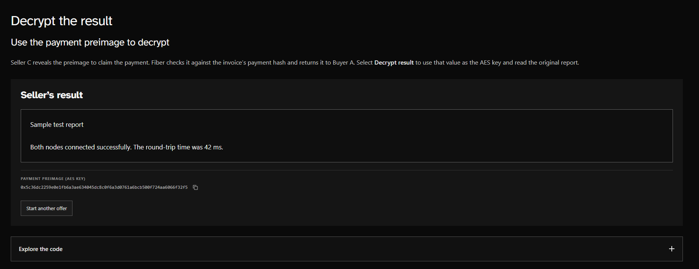
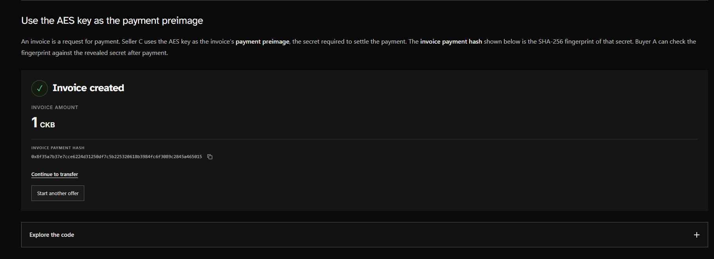

# Quest 1: Pay to unlock a report

Proof of completion of the Fiber interactive tutorial:

1. **Setup:** Both Buyer A–Bottle B and Seller C–Bottle B channels reached `CHANNEL_READY`.

   

2. **Before payment:** Buyer A received the encrypted offer, and attempting to decrypt without the key was rejected.

   

   

3. **After payment:** The receipt shows a completed payment of 1 CKB, the payment hash, and a 0.001 CKB routing fee.

   

4. **After decryption:** The buyer's decrypted result matches the seller's original sample report.

   

   

The seller's invoice provides additional evidence of the 1 CKB invoice and its payment hash:

